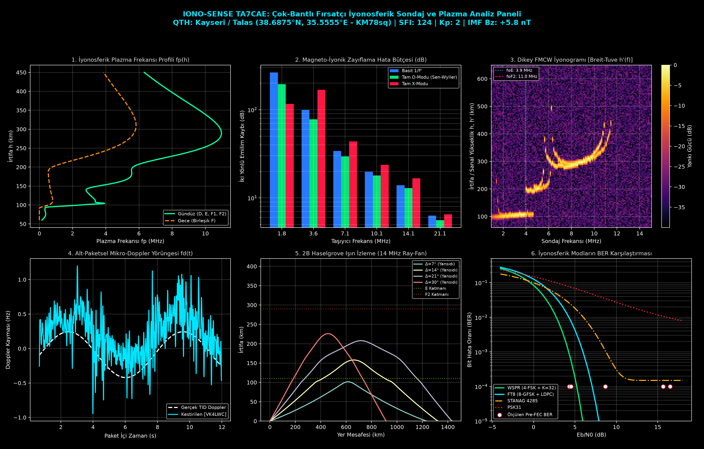

cat << 'EOF' > README.md
<div align="center">

# `sdr-ionospheric-sounding` // IONO-SENSE TA7CAE
### **HF Sayısal Modları ve SDR Kullanılarak Çok-Bantlı Fırsatçı İyonosferik Algılama: Katman Dinamikleri ve Mikro-Doppler Kestirimi**

[-critical?style=flat-square&logo=rss&logoColor=white)](https://github.com/ahmeterencokcoskun)
[-success?style=flat-square)](#)
[-blue?style=flat-square)](#)
[](#)

</div>

---

## 1. Genel Bakış ve Sistem Çıktısı

Bu depo; Nuh Naci Yazgan Üniversitesi Elektrik-Elektronik Mühendisliği Bölümü Lisans Bitirme Tezi kapsamında geliştirilen, **fırsatçı HF sayısal yayınlarını (`FT8` $`8\text{-GFSK}`$ ve `WSPR` $`4\text{-FSK}`$) pasif bir bistatik iyonosond gibi kullanarak** orta enlem Anadolu iyonosferinin ($`38.72^\circ\text{N}, 35.48^\circ\text{E}`$) katman dinamiklerini ($`\text{D}, \text{E}, \text{E}_s, \text{F}_1, \text{F}_2`$), magneto-iyonik zayıflama hata bütçesini ve alt-paketsel mikro-Doppler yörüngelerini kestiren uçtan uca sinyal işleme (DSP) ve fizik motorunu içerir.

<div align="center">
  
</div>

---

## 2. Matematiksel Çerçeve ve Modül Mimarisi

### A. Magneto-İyonik Zayıflama ($`\alpha`$) Hata Bütçesi (`plasma_physics.py`)
Literatürdeki standart sapmasız (non-deviative) $`1/f^2`$ yaklaşımı ile Kayseri jeomanyetik alanı ($`B_0 = 48.2\ \mu\text{T}`$, eğim $`I = 56.4^\circ`$, jiroskop frekansı $`f_H \approx 1.35\text{ MHz}`$) altında çözülen tam **Appleton-Hartree** ve kinetik **Sen-Wyller** modelleri arasındaki farkı (dB Discrepancy) hesaplar:

```math
\tilde{n}^2 = (\mu - j\chi)^2 = 1 - \frac{X}{1 - jZ - \frac{Y_T^2}{2(1 - X - jZ)} \pm \sqrt{\frac{Y_T^4}{4(1 - X - jZ)^2} + Y_L^2}}, \qquad \alpha_{O,X}(h) = \frac{\omega}{c}\left|\mathrm{Im}(\tilde{n}_{O,X})\right|

| Taşıyıcı Frekans       | Yansıyan Katman             | Kırılma İrtifası ($`h_{\mathrm{refl}}`$) | Basit $`1/f^2`$ Yaklaşımı | Tam O-Modu           | Tam X-Modu (Jiro-Rezonans) | Model Hata Payı |
| :--------------------: | :-------------------------: | :--------------------------------------: | :-----------------------: | :------------------: | :------------------------: | :-------------: |
| **`1.840 MHz`** (160m) | $`\text{D}`$                | $`83.5\text{ km}`$                       | $`243.88\text{ dB}`$      | $`139.66\text{ dB}`$ | $`1108.63\text{ dB}`$      | **`864.75 dB`** |
| **`3.573 MHz`** (80m)  | $`\text{D}`$                | $`88.0\text{ km}`$                       | $`101.73\text{ dB}`$      | $`68.43\text{ dB}`$  | $`201.07\text{ dB}`$       | **`99.35 dB`**  |
| **`7.074 MHz`** (40m)  | $`\text{E} / \text{E}_s`$   | $`94.5\text{ km}`$                       | $`39.34\text{ dB}`$       | $`30.90\text{ dB}`$  | $`55.19\text{ dB}`$        | **`15.84 dB`**  |
| **`10.136 MHz`** (30m) | $`\text{E} / \text{E}_s`$   | $`101.5\text{ km}`$                      | $`24.45\text{ dB}`$       | $`20.51\text{ dB}`$  | $`30.99\text{ dB}`$        | **`6.54 dB`**   |
| **`14.074 MHz`** (20m) | $`\text{F}_1 / \text{F}_2`$ | $`154.5\text{ km}`$                      | $`15.16\text{ dB}`$       | $`13.32\text{ dB}`$  | $`17.97\text{ dB}`$        | **`2.81 dB`**   |
| **`21.074 MHz`** (15m) | $`\text{F}_1 / \text{F}_2`$ | $`207.0\text{ km}`$                      | $`6.81\text{ dB}`$        | $`6.22\text{ dB}`$   | $`7.60\text{ dB}`$         | **`0.79 dB`**   |
| **`28.074 MHz`** (10m) | $`\text{F}_2`$              | $`236.0\text{ km}`$                      | $`3.85\text{ dB}`$        | $`3.59\text{ dB}`$   | $`4.18\text{ dB}`$         | **`0.32 dB`**   |
| **`50.313 MHz`** (6m)  | **Uzaya Kaçış**             | `---`                                    | $`1.24\text{ dB}`$        | $`1.19\text{ dB}`$   | $`1.29\text{ dB}`$         | **`0.06 dB`**   |

B. Ortak-Mod TCXO Kalibrasyonu ve Alt-Paketsel Mikro-Doppler (dsp_core.py)

Alıcı yerel osilatörünün (RSPdx TCXO) termal kayması
`\Delta \hat{f}_{\mathrm{common}} = \mathrm{median}(\Delta f_1, \dots, \Delta f_K)`
ortak-mod medyan kestiricisiyle sıfırlanır; modülasyon fazı soyulduktan sonra
Savitzky-Golay türev filtresiyle anlık mikro-Doppler `f_d(t)` ve dikey plazma
hareket hızı `v_z(t)` çıkarılır:

f_d(t) = \frac{1}{2\pi} \frac{d}{dt}\left[\mathrm{unwrap}\left(\arctan\frac{Q(t)}{I(t)}\right)\right] - \Delta \hat{f}_{\mathrm{common}}, \qquad v_z(t) = -\frac{c}{2 f_c \cos\theta_i} \, f_d(t)

3. Kurulum ve Çalıştırma

git clone https://github.com/ahmeterencokcoskun/sdr-ionospheric-sounding.git
cd sdr-ionospheric-sounding
python3 -m venv .venv && source .venv/bin/activate
pip install -r requirements.txt
python3 main.py

Üretilen Akademik Çıktılar

  - iono_sense_dashboard.png & iono_sense_dashboard.pdf: 6 panelli yüksek
    çözünürlüklü analiz figürü.
  - tez_bulgulari.typ: Typst formatında derlenmeye hazır tez bulguları raporu.
  - tez_bulgulari.tex: LaTeX (IEEE SİU / Tez) formatında sayısal karşılaştırma
    tablosu.
  - iono_telemetry_ta7cae.db: Zaman serisi iyonosferik ve uzay havası (NOAA
    SWPC) SQLite veritabanı. EOF git add README.md git commit -m "docs: add
    academic documentation, equations, and dashboard preview" git push


*(Artık `credential.helper store` aktif olduğu için `git push` şifre bile sormadan anında gönderecek!)*

*(Ayrıca kendi ana profilindeki `ahmeterencokcoskun/ahmeterencokcoskun` `README.md` dosyasında geçen `iono-sense-ta7cae` yazısını da `[sdr-ionospheric-sounding](https://github.com/ahmeterencokcoskun/sdr-ionospheric-sounding)` şeklinde linklersen profilinden doğrudan bu depoya tıklanabilir olur).*
